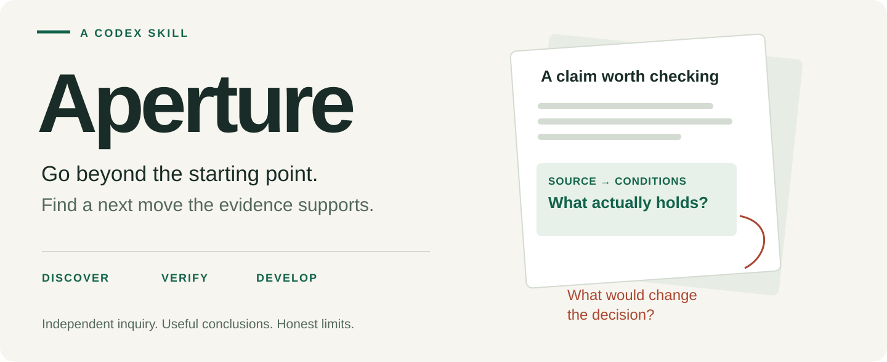

<p align="center"></p>

<p align="center"><a href="LICENSE">MIT licensed</a> · <a href="research/SKILL.md">Read the skill</a> · <a href="docs/evaluation.md">Tests &amp; evidence</a> · <a href="docs/comparison.md">Compare approaches</a></p>

# Research

A compact Codex skill for questions where discovery and evidence could change the answer.

Research helps an agent look beyond the starting idea, inspect decisive originals, challenge apparent agreement, and turn findings into useful decisions or experiments. It gives direction without requiring a fixed research pipeline, source quota, model fleet or report template.

**Use your existing Codex access and tools.** The core is a Markdown instruction file. It requires no API keys, Python packages or separate service. Web research still needs an available search/browser capability. The optional public GitHub snapshot helper uses Python's standard library.

## Install

Clone the repository, then copy **only the `research` folder** into your personal skills directory:

```sh
git clone https://github.com/nazeeh111/research-skill.git
mkdir -p "$HOME/.agents/skills"
test ! -e "$HOME/.agents/skills/research" && \
  cp -R research-skill/research "$HOME/.agents/skills/research"
```

If `research` already exists, the command leaves it alone. Compare and back up your existing version before updating. Start a new Codex session if it has not discovered the skill. For repository-scoped use, copy the same folder into `.agents/skills/` in your project. See [official Codex skill guidance](https://developers.openai.com/codex/skills/).

## Use

Invoke it as `$research`, or select Research from your client's skill picker. Clients may show slash-style shortcuts; the portable prompt form is `$research`.

```text
Use $research to investigate a free local archive for web articles and
scanned PDFs. Inspect primary documentation, compare feasible routes,
preserve originals, and design a pilot that could overturn the choice.
```

```text
Use $research to challenge this proposal. Treat these links as starting
points, find overlooked mechanisms, and tell me what evidence would
change the decision.
```

Research can also be selected automatically for substantial investigation. Straightforward answers, routine implementation and self-contained creative work can stay direct. It works on its own and can complement other skills already in use; it does not require them.

## What it changes

| Situation | Research's direction |
| --- | --- |
| The prompt names a few examples | Follow their references and discover unfamiliar candidates. |
| Several pages repeat one claim | Trace their shared origin before treating them as corroboration. |
| A new article describes an old result | Separate publication date, observed period and artifact version. |
| A feature sounds promising | Inspect the relevant code, method, figure or demonstration. |
| A creative route looks unusual | Explain its mechanism, restore binding constraints and test the hardest assumption. |
| Evidence is missing or access fails | Bound the conclusion and preserve useful actions and open questions. |

These are instructions to the agent, not mechanically enforced guarantees. Results depend on the model, tools, source access and task.

## Evidence before claims

The release includes a matched four-case comparison of the pre-refinement core against the same agent without optional skill instructions: three fictional evidence packets and one live technical investigation. It also includes offline tests, frozen grading criteria and both complete responses. Independent review found a source-interpretation error in the Research response; the final core adds a focused reminder to check configuration before declaring a blocker. Read [the evaluation](docs/evaluation.md) for the original scores, correction and limits. This small developer-built evaluation does **not** establish general superiority, universal reliability or a causal improvement in creativity.

The [comparison guide](docs/comparison.md) separately examines three public skills at fixed revisions. That is a source-based architecture comparison; their pipelines were not run.

## Optional source snapshots

When preserving exact public source bytes matters:

```sh
python3 research/scripts/snapshot_github.py \
  --repo OWNER/REPOSITORY \
  --commit FULL_40_CHARACTER_COMMIT_SHA \
  --path path/to/file.py \
  --out /absolute/path/to/new-snapshot
```

Repeat `--path` for additional files. The destination must be new and its parent must exist. The helper records revision, source URLs, SHA-256 hashes and failures; it refuses redirects and stops at the first failure. Partial downloads remain available with their manifest. Exit codes: `0` complete, `1` failed/partial/refused, `2` invalid arguments, `130` interrupted. It does not resolve revisions, verify a Git blob independently, read sources, judge claims or grant redistribution rights. Disk failures may prevent a final manifest update.

## Develop

```sh
python3 -W error::ResourceWarning -m unittest discover -s tests -v
```

No paid evaluation service is needed. See [the evaluation protocol](evaluation/protocol.md) to repeat the behavioral cases with your own agent and tools. CI runs offline code/package checks; it does not rerun model evaluations.

Contributions should fix an observed problem or improve a realistic task. Include the input, actual result, expected behavior and the smallest useful check. Keep private inputs and credentials out of issues. Avoid adding mandatory stages or dependencies without evidence that they earn their cost.

## License

[MIT](LICENSE). Written and maintained by [Nazeeh Abdul-Hadi](https://github.com/nazeeh111). Public comparison sources remain owned and licensed by their respective authors; their source files are not bundled here.
