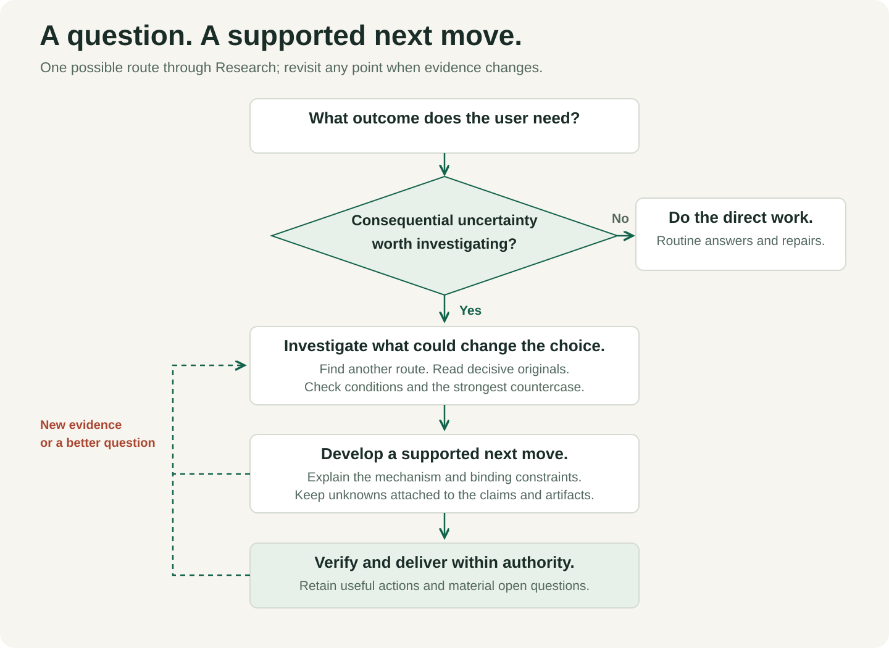

<p align="center"></p>

<p align="center"><a href="#install">Install</a> · <a href="#try-it">Try it</a> · <a href="research/SKILL.md">Read the skill</a> · <a href="docs/real-world-evaluation.md">Real-world evaluation</a> · <a href="docs/comparison.md">Compare approaches</a></p>
<p align="center"><a href="https://github.com/nazeeh111/aperture/actions/workflows/check.yml"></a> <a href="LICENSE"></a></p>

# Aperture

A compact Codex skill for questions where **better discovery or stronger evidence could change what you do**.

Start with an idea, a link or an uncertain decision. Research guides the agent to find overlooked routes, inspect decisive originals, test the assumptions that matter and deliver something useful. It adapts to the question instead of prescribing a fixed research pipeline or a report template.

**Works with your existing Codex access.** The core needs no API keys, Python packages or separate service. Live investigation needs search/browser tools available in your host. It can work alone or complement other skills already in use.

## Install

Clone the repository, then copy **only `research/`** into your personal skills directory:

```sh
git clone https://github.com/nazeeh111/aperture.git
mkdir -p "$HOME/.agents/skills"
test ! -e "$HOME/.agents/skills/research" && \
  cp -R aperture/research "$HOME/.agents/skills/research"
```

The guarded copy leaves an existing installation alone. Back up and compare your version before updating. For a project installation, copy the same folder into `.agents/skills/` in that repository. Codex detects skill changes; restart it if the skill does not appear. [Official skill guidance](https://developers.openai.com/codex/skills/).

Prefer a download? Get the installable ZIP and SHA-256 checksum from the **[latest release](https://github.com/nazeeh111/aperture/releases/latest)**. Extract the `research` folder into your skills directory. The ZIP includes the MIT license.

## Try it

Invoke **`$research`**, select Aperture Research in your client's skill picker, or let Codex choose it for a substantial investigation. Client shortcuts vary; `$research` is the portable prompt form.

```text
Use $research to investigate this idea. Treat these links as starting
points, find overlooked mechanisms, and tell me what evidence could
change the decision. Deliver a route we can actually test.
```

Three natural starting points:

| Your question | A useful result |
| --- | --- |
| “Can we keep offline notes in sync without a paid service?” | A feasible platform route that separates synchronization, version history and independent recovery. |
| “Is this dataset good enough for our comparison?” | Actual schema/record checks, applicable coverage and a defensible denominator. |
| “Can this public collection supply reusable exhibit images?” | Item-level source/rights records with uncertainty attached to each artifact field. |

Keep straightforward answers, routine implementation and self-contained creative work direct. Research is for uncertainty worth investigating.

## How it works

Start with the intended outcome. If consequential uncertainty is worth investigating, follow promising leads, inspect decisive sources, develop a supported move and verify the authorized result. Otherwise keep the work direct. New evidence can reopen the question at any point.

<p align="center"></p>

The flowchart illustrates one possible route. The core emphasizes a few consequential choices:

- **Explore beyond the seeds.** Follow unfamiliar candidates, different mechanisms and substantive surprises.
- **Check the claim that changes the decision.** Read the original location and its conditions; look for the strongest countercheck.
- **Check feasibility together.** A default is not a hard limit, and features from incompatible environments do not establish a usable route.
- **Keep uncertainty attached.** An inferred URL or unverified number must be marked where it appears, including in tables and files.
- **Finish within authority.** Carry authorized work through relevant verification and delivery; preserve unresolved obligations.

These are instructions to an agent, not mechanical guarantees. Model judgment, tool access and the quality of the available evidence still matter.

## Evidence you can inspect

The **[real-world evaluation](docs/real-world-evaluation.md)** found 5 Research preferences, 2 ties and 1 native preference across eight repeated pairs. It separates development cases from untouched comparison tasks, uses independent executions and blind review, and retains complete answers, adverse results, a reviewer-exposure issue and fresh crosscheck differences. The final coverage reminder was checked separately after the scored comparison. It evaluates useful decisions and source support, rather than rewarding longer reports or more citations.

The **[first release evaluation](docs/evaluation.md)** remains available: native baseline 48/48 versus Research 47/48 on a small four-case rubric. Review found a missed Recoll setting; a focused reminder was added. That short follow-up did not establish comparative improvement. Historical results have not been overwritten by later tests.

The **[public-skills comparison](docs/comparison.md)** separately examines three alternatives at fixed revisions. Their pipelines were not run. No single small evaluation establishes universal superiority, creativity or reliability.

## Optional exact-source snapshots

When selected public repository bytes need to accompany an investigation:

```sh
python3 research/scripts/snapshot_github.py \
  --repo OWNER/REPOSITORY \
  --commit FULL_40_CHARACTER_COMMIT_SHA \
  --path path/to/file.py \
  --out /absolute/path/to/new-snapshot
```

The helper uses Python's standard library. Repeat `--path` for additional files. Its fresh destination must have an existing parent. It retains revision, source URLs, SHA-256 hashes and partial failures, refuses redirects and stops at the first failure. It does not resolve revisions, independently verify Git blobs, read sources, judge claims or grant redistribution rights. See [helper details](docs/snapshots.md).

## Develop and contribute

```sh
PYTHONDONTWRITEBYTECODE=1 python3 -W error::ResourceWarning -m unittest discover -s tests -v
```

Offline checks cover the helper and release integrity. CI does not run model comparisons. To reproduce behavioral comparisons, follow the published protocols in [evaluation/](evaluation/).

Propose a change with a realistic input, actual outcome, expected improvement and the smallest useful check. Keep private inputs and credentials out of issues. Add instructions or dependencies only when their contribution earns their cost.

## Presentation and license

Original editable SVG figures use the **[PaperBanana for Codex skill](docs/presentation.md)** for planning, styling, local rendering and visual critique. The upstream API-backed generation pipeline was not run. No separately billed image or model API was used.

[MIT licensed](LICENSE). Maintained by [Nazeeh Abdul-Hadi](https://github.com/nazeeh111). Compared projects and referenced collections retain their own ownership and licenses.
