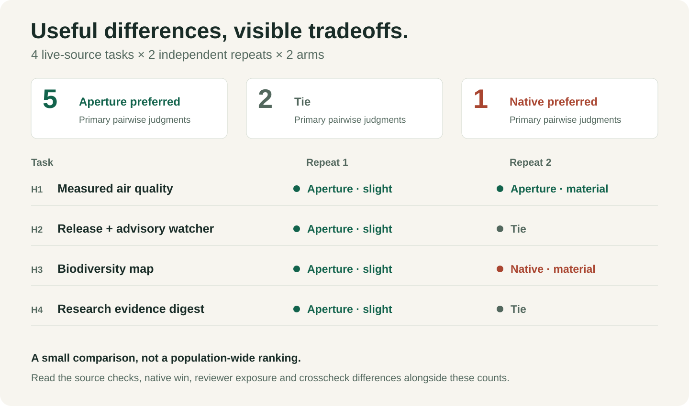

# Real-world evaluation

This follow-up asks a harder question than the first release: **does Research add a checked practical benefit beyond an already capable native agent?** It uses current primary sources and realistic deliverables, keeps development separate from the final comparison, repeats each final case and preserves unsuccessful results.

## Results and practical value

The primary reviewers preferred the tested Research candidate in **5 of 8 pairs**, tied **2**, and preferred native work in **1**. Four Research preferences were slight and one was material. Native's win was material. Rubric totals were **177/192 for Research and 167/192 for native**; these ordinal scores are summaries, not effect-size or significance estimates.

| Task | Repeat 1 | Repeat 2 |
| --- | --- | --- |
| Measured Chicago air quality | Research, slight | Research, material |
| Release/advisory watcher | Research, slight | Tie |
| Bee observation map | Research, slight | Native, material |
| Evidence digest | Research, slight | Tie |

**Checked value:** in H1-R2, Research acquired both EPA site-year CSVs, exposed mixed instrument/parameter streams and supplied a real record. The first reviewer and parent independently reproduced **113,895 / 96,622 bytes, exact hashes and 384 / 326 rows**, including **60 regulatory-stream rows per year**. Native supplied a documented schema and an uncompleted acquisition plan. This is a checked practical benefit on an untouched task, not proof the instruction alone caused it. The returned data do not establish neighborhood representativeness or a completed statistical comparison.

**A meaningful native win:** H3-R2 native work supplied a standard-library SVG map generator, while Research left map layout to QGIS. Independent synthetic fixtures verified that the native code produces a parseable map and deduplicated ledger. Research preserved better raw provenance and explicit filtering, but did not match that operating-work reduction. Neither completed a live regional harvest.

**A source-coverage weakness:** watcher results exposed different advisory coverage. Parent unauthenticated reads reproduced 86 global reviewed records and 61 upstream records, with only 29 shared IDs. Both sets had real package-relevant omissions relative to the other; source count alone would choose badly. This is a source-scope observation, not a complete audit of every advisory's applicability.

## Reviewer exposure, crosscheck and adjudication

The H1/H2 reviewer encountered an arm-revealing candidate path in evidence metadata. That batch was **not fully blind**. Original preferences and scores are retained. The second task reviewer received sanitized metadata. A fresh sanitized crosscheck of H1-R2 and H2-R2 was conducted without earlier reviews, scores or the arm map.

The crosschecker preferred Research only slightly in H1-R2 because EPA access failed in that context, so it could not independently certify the numerical acquisition. The first reviewer and parent did reproduce the exact bytes using bounded public network access. The parent's first verifier mistakenly treated the broker's HTML link page as CSV; that failed check is retained, followed by a corrected check that follows the temporary CSV link as the submitted code requires. No failed retrieval is counted as successful.

In H2-R2 the fresh crosschecker materially preferred Research's stateful watcher after simulated baseline, failure-preservation and older-branch-release tests. The primary reviewer retained a tie because actual source coverage advantages went both ways. We keep the primary tie, rather than replacing it with a more favorable review. The fresh crosscheck's inability to access an endpoint is an unavailable check, not a refutation of a successful independently reproduced retrieval.

This meets the frozen **bounded usefulness** gate: at least one independently verified material benefit without a newly demonstrated critical failure pattern attributable to the candidate. It does not establish broad superiority, eliminate variation or erase the native win.

## Final repair and version scope

The eight pairs measure the exact [tested candidate](../evaluation/v2/inputs/tested-candidate.txt). After the advisory counterexamples, the final core adds one narrow sentence: when coverage matters, test what each source can miss with concrete counterexamples. The UI display name becomes **Aperture Research**, while `$research`, description and implicit-invocation policy remain unchanged.

The [post-repair probe](../evaluation/v2/final-probe/answer.md) reran the watcher request once in a fresh context with the final core. It selected both repository and global package advisories, identified a real advisory published after the latest release, retained complete stable-release status, and qualified shared source origins. Filtering/pagination fixtures passed; live integration was unavailable in that worker. This is a targeted regression probe on a known task, not another untouched comparison or a causal test. The final extra sentence and UI label are **not included in the eight-pair scores**. No further benchmark tuning or winner-seeking reruns were performed.

## Design

| Set | Tasks | Executions | Purpose |
| --- | --- | ---: | --- |
| Development | Reusable museum image evidence pack; Android/macOS notes recovery | 4 | One run per native/current-skill arm, diagnose weaknesses. |
| Untouched comparison | Chicago PM2.5 archive; Pillow updates/advisories; bee observation map; direct-air-capture digest | 16 | Four tasks × two independent repeats × two arms. |

These are constructed realistic requests, not actual client commissions. Sources and records are real. The native arm uses the same inherited model/effort and available tool surface, without optional skill instructions. The Research arm loads only its assigned frozen core. No other skill, model override, separate API provider, new account, installation or external write is allowed in executions. There were 20 comparison executions plus one targeted post-repair probe; source/visual reviews and parent verification add work beyond those execution counts. Total tokens and overall effort are unmeasured.

Before any comparison execution, the candidate bytes and final brief hashes were frozen. The holdout briefs were shortened from verbose preflight briefs to natural user requests so both arms were not explicitly given the skill's methodology. This happened after development and before any holdout execution; the original freeze and the reason are retained. Each run uses a fresh context and its first result is retained. There are no rerolls or best-of selections.

Reviewers were intended to receive anonymous, counterbalanced left/right outputs, the task and a frozen rubric; the exposure and repair are disclosed above. They check decisive primary claims and material differences. The six dimensions are source support, constraints/feasibility, useful alternatives, decisive inspection, actionable output and verification/uncertainty. Each is scored 0–4, for 24 points per run. Point totals summarize the rubric; a consequential failure cannot be canceled by a high total.

A material benefit must enable an action, change a decision, reduce operating work or prevent a failure, and be independently source-checked. More text, more citations, different tool names and persuasive prose do not count. Native-only benefits count too.

## Development findings and intervention

The museum pair was a tie with both handoffs incomplete: neither delivered three fully verified usable image links. Research's CSV included an inferred URL without field-local status; its narrative caveat did not repair the artifact. The notes pair slightly favored native work: it checked the actual Mac application's compatibility and independent Git-history recovery, while Research added useful Android storage/battery details.

The staged candidate therefore adds three connected operations:

1. For a choice-changing claim, establish the exact claim, original location, applicable conditions and strongest countercheck. Keep this working map internal unless the user needs it.
2. Validate the requirements that make a route usable together on compatible environments, rather than combining unrelated examples.
3. Mark inferred, unverified and missing values where they appear in files and recommendations.

This is a bundled intervention. The experiment cannot isolate which instruction causes a difference. It adds no source quota, mandatory report, required agent fleet or external service.

## Reading the evidence

The published protocol, briefs, source snapshots, original responses, selected source-evidence records and blind reviews are available under [evaluation/v2/](../evaluation/v2/). The [first-release evaluation](evaluation.md) remains unchanged as historical evidence, including its lower Research score and correction.

Each final run reports source-access errors and the verification actually achieved. A documentation/schema example is not a downloaded dataset; a syntax or mocked check is not a successful live integration. Reproducible plans can be useful while their runtime outcome remains unresolved.

## Limits

This is a small, developer-built comparison across four domains, with two repeats per arm. It can demonstrate particular useful discoveries and expose failures; it cannot establish population-wide superiority, universal reliability or a causal benefit from each bundled instruction.

Review is independent in context and uses the same model family. Intended blinding was imperfect in one batch and is disclosed above, with a sanitized crosscheck. Exact backend model ID, sampling seed, complete native tool traces, token usage and monetary accounting are unavailable from this host. Worker evidence files are selected records, not exhaustive traces. Clock intervals, when present, are worker-observed and may exclude final writing; concurrent tool access and changing live sources also limit timing interpretation. No speed, token-efficiency or cost advantage is claimed.

The comparison tests explicit instruction-conditioned execution. It does not test automatic skill selection or the user's complete 01/Moonshot/Research system. No paid API was used. The acceptance gate requires at least one independently verified material benefit on untouched tasks without a new critical failure pattern; negative and offsetting results must remain visible.
